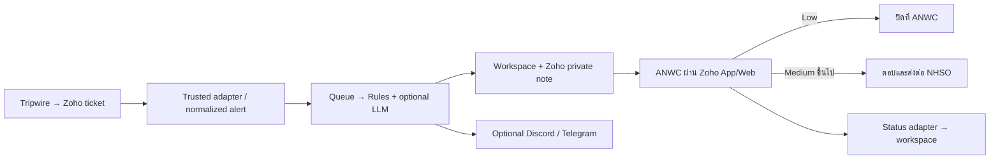

# ประสิทธิโชค · Prasittichoke

เว็บสำหรับคัดกรอง FIM alerts และติดตามงาน SOC ของ ANWC → NHSO เน้นเรียบง่าย: Node.js 24 + Express + SQLite + HTML/CSS/JavaScript ไม่ต้องมี frontend build หรือฐานข้อมูลแยก

ชื่อผลิตภัณฑ์และโฟลเดอร์คือ **prasittichoke** ส่วน GitHub repository คือ **sabaszx/prasittichotte** ตาม URL ที่เจ้าของโครงการระบุ

## เริ่มใช้งานในเครื่อง

ต้องมี Node.js 24.15 ขึ้นไปในสาย 24.x

```powershell
cd 'C:\Users\ChayanonSukkhat\Documents\Side Projects\prasittichoke'
npm.cmd ci
npm.cmd start
```

เปิด http://localhost:3000 แล้วกด **โหลดเคสตัวอย่าง** ระบบเริ่มในโหมด demo ซึ่งไม่เรียก LLM, Zoho, Discord หรือ Telegram ภายนอก สามารถดูหลักฐาน คัดลอกร่างคำตอบ ทดลองปิด Low และทดลองส่งต่อ Medium ขึ้นไปได้

ฐานข้อมูลจะอยู่ใน `data/` และถูก ignore จาก Git โหมด demo กับ live ต้องใช้ฐานข้อมูลคนละไฟล์/volume เพื่อไม่ให้ข้อมูลตัวอย่างปนกับเคสจริง

## สิ่งที่ทำได้ในรุ่น 0.1

- Dashboard ภาษาไทย รองรับจอ desktop/mobile พร้อมค้นหาและกรองเคส
- แยก source severity, recommendation และ human decision
- Rules baseline แบบ conservative พร้อมเหตุผล หลักฐาน และรายการข้อมูลที่ขาด
- Optional LLM adapter สำหรับ HTTPS chat-completions JSON endpoint; validate schema และป้องกันการลด severity ต่ำกว่ากฎ
- SQLite durable queue, revision checks, duplicate detection และ audit trail
- Demo intake และ decision workflow ที่ทดลองได้จริง
- Live ingestion API แบบ normalized พร้อม bearer authentication
- Zoho OAuth refresh + private note writer และ deep link กลับไปยังเคส
- API สำหรับรับสถานะที่ยืนยันจาก Zoho ผ่าน trusted adapter
- Discord/Telegram notification adapters (ปิดโดย default)
- Login สำหรับ live mode, same-origin protection, CSP และไม่เปิด secret ผ่าน API
- Tests, Docker, GitHub Actions CI/image publishing และ manual deployment workflow สำหรับ VPS

## ขอบเขตที่ต้องรู้ก่อนเชื่อมของจริง

1. **ยังไม่ได้เชื่อม tenant จริง** ไม่มี credentials หรือ alert payload จริงขององค์กรในการพัฒนารุ่นนี้
2. `/api/ingest` รับรูปแบบกลางของโปรเจกต์ ไม่ใช่ raw Zoho webhook หรือ raw Tripwire message โดยตรง ต้องทำ mapping ใน Zoho custom function/adapter ตาม [integration contract](docs/integrations.md) และทดสอบกับตัวอย่างจริง
3. ANWC ตอบ ปิด และส่งต่อเคสจริงใน **Zoho Desk App/Web** เว็บนี้เป็น workspace สำหรับตรวจข้อมูล ไม่ส่ง public reply หรือเปลี่ยน assignee/status เอง
4. สถานะจริงบนเว็บมาจาก adapter ที่ส่งข้อมูลยืนยันกลับมา หากยังไม่เชื่อม status sync จะยังแสดงรอ ANWC ไม่สมมติว่าส่งต่อสำเร็จ
5. Rules เป็น baseline ยังไม่ครอบคลุมกฎทุกข้อใน prompt เดิม และยังไม่ได้วัดผลกับชุดข้อมูล SOC จริง; ไม่มี confidence 95% แบบตายตัว
6. ไม่มี CMDB/change-management connector อัตโนมัติ ข้อมูล maintenance ใน API ต้องมาจากแหล่งที่ตรวจสอบแล้ว `verified=true` เป็นข้อยืนยันของ trusted adapter ไม่ใช่ผลที่โมเดลสร้าง
7. Auth รุ่นแรกเป็นรหัสผ่านผู้ดูแลร่วม ยังไม่มี SSO/RBAC รายบุคคล ใน live mode ตัวตนผู้อนุมัติต้องมาจาก Zoho adapter; ไม่ใช้ shared login เป็นหลักฐานแทนผู้อนุมัติ
8. ยังไม่มี SLA reminder scheduler, early critical notification, attachment extraction หรือหน้าจอแก้ไขกฎ; ควรเปิด Zoho notifications เดิมควบคู่ใน pilot
9. เก็บรายการเคสล่าสุดสูงสุด 500 รายการบน UI; SQLite/worker เดียวเหมาะกับ pilot บน VPS เดียว ยังไม่ออกแบบสำหรับหลาย replicas
10. redaction เป็น best-effort สำหรับ secret และ email ที่พบบ่อย ไม่ใช่ DLP ครบทุกชนิด ต้องอนุมัติ data boundary ก่อนเปิด LLM

## Workflow



SYSTEM ไม่เท่ากับ LOW ทุก Medium ขึ้นไปต้องตอบและส่งต่อ รวม SYSTEM การอนุมัติผูกกับ revision ของหลักฐานใหม่ล่าสุด

## ตรวจสอบ

```powershell
npm.cmd run check
npm.cmd test
npx.cmd playwright install chromium
npm.cmd run test:e2e
npm.cmd audit --omit=dev --audit-level=high
```

Browser test ใช้ฐานข้อมูลในหน่วยความจำและพอร์ต 3100 ไม่แตะข้อมูล local demo รูปหน้าจอและ trace อยู่ใน `test-results/`

## Deploy / CI-CD

ดู [คู่มือติดตั้ง VPS](docs/deployment.md) สำหรับ Docker Compose, HTTPS, GitHub Secrets, backup และ rollback

- Pull request: tests + browser test + Docker build/smoke test
- Push main: ผ่านทุก check แล้ว publish `ghcr.io/sabaszx/prasittichotte:<commit-sha>`
- Deploy to VPS: เลือก SHA ของ image ที่ผ่าน CI ผ่าน workflow dispatch โดยใช้ GitHub Environment `production`
- ยังไม่ deploy โดยอัตโนมัติจากทุก push เพื่อให้ pilot เลือกรุ่นได้ชัดเจน เมื่อ workflow/tenant ผ่าน UAT แล้วค่อยปรับ trigger

## โครงสร้าง

```text
src/domain.js          validation, redaction, policy, demo fixtures
src/store.js           SQLite schema v1, queue, audit, revision guards
src/integrations.js    LLM, Zoho private notes, Discord, Telegram
src/server.js          HTTP, auth, ingest, worker, static web
public/                responsive web workspace
test/                  unit/API/browser tests
docs/                  integration contract, deploy runbook
scripts/               database backup, VPS deploy
.github/workflows/     CI + image publishing + deployment
```

## แหล่งอ้างอิง

- [Zoho Desk API](https://desk.zoho.com/DeskAPIDocument)
- [Zoho Webhook events](https://desk.zoho.com/support/WebhookDocument.do)
- [Discord Execute Webhook](https://docs.discord.com/developers/resources/webhook#execute-webhook)
- [Telegram sendMessage](https://core.telegram.org/bots/api#sendmessage)
- [Node SQLite](https://nodejs.org/api/sqlite.html)
- [GitHub publishing Docker images](https://docs.github.com/en/actions/tutorials/publish-packages/publish-docker-images)
# prasittichotte

